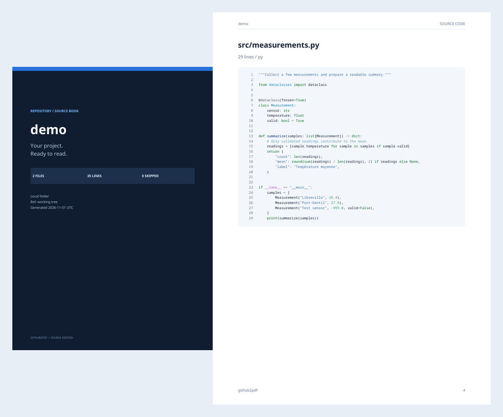

<div align="center">

# github2pdf

### Votre dépôt, prêt à lire et à partager.

Transformez un projet GitHub ou un dossier local en un PDF de code source
avec couverture, sommaire cliquable, coloration syntaxique et numéros de ligne.

[](https://github.com/Yusufibin/github2pdf/actions/workflows/ci.yml)
[](pyproject.toml)
[](CHANGELOG.md)
[](LICENSE)

[Installation](#installation) · [Exemples](#utilisation) · [PDF de démonstration](docs/github2pdf-demo.pdf) · [Contribuer](CONTRIBUTING.md)



</div>

## Ce que ça apporte

- **Lecture confortable** : couverture, en-têtes, pagination et code coloré avec Pygments.
- **Navigation directe** : sommaire cliquable et signets par fichier.
- **Lignes préservées** : les longues lignes passent à la ligne et les blocs continuent sur la page suivante.
- **GitHub ou local** : export depuis une URL, `owner/repo` ou un dossier, sans réseau en mode local.
- **Bonne référence** : détection de la branche par défaut ; sélection d’une branche, d’un tag ou d’un commit avec `--ref`.
- **Provenance** : le PDF GitHub indique la référence et le commit exact de l’archive exportée.
- **Sélection explicite** : filtres de chemins, extension et limites de taille ; fichiers omis récapitulés dans le PDF.
- **Polices embarquées** : pas de police système à installer ; accents et caractères latins pris en charge.

## Installation

**Python 3.10 ou supérieur** est nécessaire. Installation isolée avec [uv](https://docs.astral.sh/uv/) :

```bash
uv tool install git+https://github.com/Yusufibin/github2pdf.git
```

Ou avec pipx :

```bash
pipx install git+https://github.com/Yusufibin/github2pdf.git
```

Depuis les sources, dans un environnement virtuel :

```bash
git clone https://github.com/Yusufibin/github2pdf.git
cd github2pdf
python -m venv .venv
# Linux / macOS
source .venv/bin/activate
# Windows PowerShell : .venv\Scripts\Activate.ps1
python -m pip install .
```

Ces commandes installent le projet depuis GitHub ou les sources. Aucune publication sur PyPI n’est requise.

## Utilisation

```bash
# Détecter automatiquement la branche par défaut
github2pdf https://github.com/Yusufibin/tablo

# Forme courte + chemin de sortie
github2pdf Yusufibin/tablo -o exports/tablo.pdf

# Choisir une branche, un tag ou un commit
github2pdf owner/repo --ref feature/my-branch

# Exporter un dossier local, sans requête réseau
github2pdf ./mon-projet -o projet.pdf

# Ne garder que le Python
github2pdf ./mon-projet --lang py

# Combiner des filtres glob ; les guillemets empêchent le shell de les développer
github2pdf owner/repo --include 'src/*' --include '*.md' --exclude 'tests/*'

# Papier Letter, limites personnalisées et détail des fichiers omis
github2pdf owner/repo --page-size letter --max-files 100 --max-file-bytes 128000 --verbose
```

Sans `--output`, le résultat est écrit dans `<nom-du-projet>-source.pdf`.
Les dossiers de sortie sont créés automatiquement. Un échec de rendu conserve le PDF existant.

### Dépôts privés et limites GitHub

Définissez `GITHUB_TOKEN` dans votre environnement ou votre gestionnaire de secrets.
Le jeton doit avoir accès en lecture au dépôt visé. Il est transmis à l’API GitHub,
jamais ajouté au PDF ni aux messages d’erreur. Les dépôts publics fonctionnent sans jeton,
dans les limites de l’API GitHub.

### Options

| Option | Effet | Défaut |
| --- | --- | --- |
| `--ref` | Branche, tag ou commit GitHub | Branche par défaut |
| `-o`, `--output` | Chemin du PDF | `<projet>-source.pdf` |
| `--page-size` | `A4` ou `letter` | `A4` |
| `--include` | Chemin ou nom de fichier au format glob ; répétable | Tous les fichiers texte admissibles |
| `--exclude` | Motifs glob à exclure ; répétable | Aucun motif supplémentaire |
| `--lang` | Extension unique, par exemple `py`, `rs` | Toutes |
| `--min-lines` | Minimum de lignes non vides | `1` |
| `--max-files` | Nombre maximal de fichiers exportés | `500` |
| `--max-file-bytes` | Taille maximale par fichier | `256 000` octets |
| `-v`, `--verbose` | Liste complète des fichiers omis | Désactivé |
| `--version` | Afficher la version | — |

Les motifs sont sensibles à la casse et s’appliquent au chemin relatif ou au nom du fichier.
Ils suivent `fnmatch` : `*` peut aussi correspondre à un séparateur de dossier.
Les exclusions de base restent prioritaires sur `--include`.

## Fichiers inclus et limites

Les sources, tests, fichiers Markdown et configurations texte sont inclus par défaut.
Les environnements virtuels, dépendances installées, dossiers de compilation, fichiers
binaires et principaux fichiers de verrouillage sont ignorés. Les noms sensibles courants
(`.env*`, clés privées, `.npmrc`, etc.) et les liens symboliques sont exclus.
**Ce filtrage de noms ne détecte pas les secrets écrits dans un fichier source ordinaire.**

- Lecture UTF-8 et UTF-16 avec BOM. Les encodages non reconnus sont signalés et omis.
- Les caractères absents des polices sont représentés explicitement sous la forme `[U+XXXX]`.
- Budget de lecture du contenu : 20 Mo ; archive téléchargée : 50 Mo maximum.
- Archives limitées à 20 000 entrées et 250 Mo décompressés déclarés ; aucune extraction sur disque.
- Les gros fichiers sont omis intégralement, jamais tronqués silencieusement.
- En local, les fichiers actuels sont exportés, y compris les fichiers non suivis par Git.
- Les sous-modules, fichiers Git LFS distants et pièces jointes binaires ne sont pas récupérés.

Le PDF montre le code Markdown, HTML, SVG et les autres sources tels quels ; il ne les exécute pas.

## Migration depuis le script initial

Le lancement historique reste disponible :

```bash
python github2pdf.py owner/repo --branch_or_tag main --page_size A4 --min_lines 1
```

Les anciennes options `--branch_or_tag`, `--page_size` et `--min_lines` restent reconnues.
`--exclude` utilise désormais des **glob**, et non des expressions régulières.
La sélection par défaut conserve aussi les tests, la documentation et les petits fichiers.
Le projet expose maintenant les modules `source`, `render` et `models` ; l’ancienne classe
monolithique `GithubToPDF` est remplacée par `load_source()` et `write_pdf()`.

## Développement

```bash
uv sync --extra dev
uv run ruff check .
uv run ruff format --check .
uv run pytest -q
uv build

# Reproduire la démonstration du README
uv run github2pdf examples/demo -o output/pdf/github2pdf-demo.pdf
```

La CI vérifie Python 3.10 et 3.14, les filtres et erreurs réseau simulées, les archives,
la pagination et les liens PDF, puis construit le paquet et teste son installation
hors du dossier source. Les tests ne nécessitent ni réseau GitHub ni jeton.

| Module | Responsabilité |
| --- | --- |
| `github2pdf/cli.py` | Arguments, messages et codes de sortie |
| `github2pdf/source.py` | Lecture locale, API GitHub et filtres |
| `github2pdf/models.py` | Documents, fichiers et options |
| `github2pdf/render.py` | Mise en page, code coloré et navigation PDF |
| `tests/` | Tests de régression |

## Licence et crédits

Code sous [licence Apache 2.0](LICENSE).
Rendu PDF avec [ReportLab](https://www.reportlab.com/), coloration avec [Pygments](https://pygments.org/).
Les polices Noto Sans et Noto Sans Mono sont embarquées avec leurs licences SIL Open Font License
et leurs mentions de copyright dans [`github2pdf/assets/`](github2pdf/assets/).
